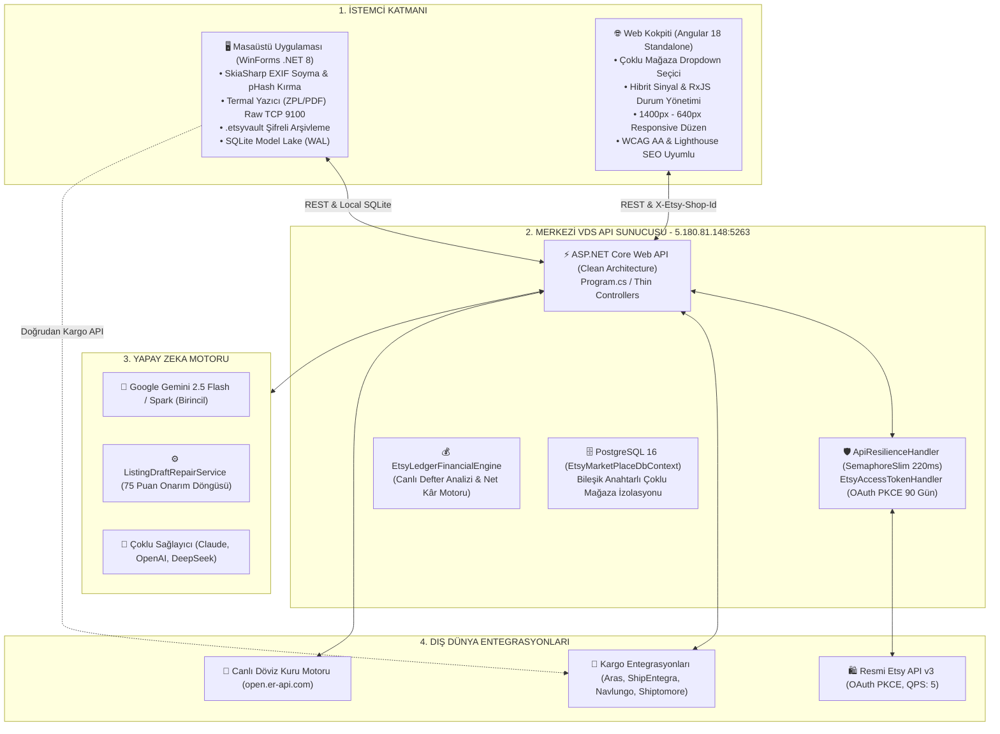
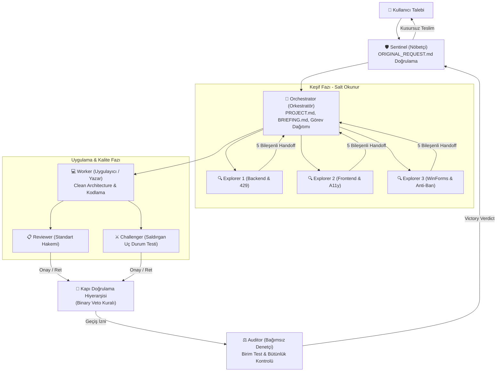

# EtsyMarketPlace: Kapsamlı Sistem Mimarisi, Clean Architecture ve Teamwork Çoklu Ajan (Multi-Agent) Raporu

> **DOKÜMAN STATÜSÜ:** TEKNİK MİMARİ VE ÇOKLU AJAN BAŞVURU BELGESİ (TECHNICAL ARCHITECTURE & TEAMWORK REFERENCE)  
> **YAZAR:** Teamwork Technical Documentation Author (`teamwork_worker`)  
> **TARİH:** 6 Kasım 2026  
> **DİL:** Türkçe (Turkish)  
> **REFERANSLAR:** `SYSTEM_ARCHITECTURE_AND_AGENT_HANDBOOK.md`, `ORIGINAL_REQUEST.md`, `docs/finans-motoru-ve-parite.md`, `.agents/teamwork/explorer_[1,2,3]/report.md`

---

## İÇİNDEKİLER

1. [Yönetici Özeti ve Proje Kapsamı (Executive Summary)](#1-yönetici-özeti-ve-proje-kapsamı-executive-summary)
2. [Genel Sistem Mimarisi & Clean Architecture Analizi](#2-genel-sistem-mimarisi--clean-architecture-analizi)
   - 2.1. Sistemin Var Oluş Amacı ve Çözülen Temel Problemler
   - 2.2. Büyük Resim: 4 Temel Katman ve Veri Akışı
   - 2.3. Clean Architecture Katman Ayrımı (Domain, Application, Infrastructure, Api)
   - 2.4. İnce Controller (Thin Controller) ve Bağımlılıkların Tersine Çevrilmesi (DIP)
   - 2.5. MediatR CQRS Pipeline Davranışları ve Validasyon
3. [Çoklu Mağaza (Multi-Shop) Mimarisi](#3-çoklu-mağaza-multi-shop-mimarisi)
   - 3.1. Backend Mağaza Çözümleme Stratejisi (`BaseApiController.ResolveShopId`)
   - 3.2. PostgreSQL Veritabanı Şeması ve Bileşik Anahtarlı Veri İzolasyonu
   - 3.3. Kullanıcı Yetkilendirmesi (`AppUser.AssignedShopIds`)
   - 3.4. Frontend Üst Gezinti Çubuğu Çoklu Mağaza Seçici (`ShellComponent`)
   - 3.5. Reaktif Sinyal (`activeShopId`) ve Durum Kalıcılığı (`localStorage`)
4. [Etsy API 429 Rate Limiter & Dayanıklılık Mekanizması](#4-etsy-api-429-rate-limiter--dayanıklılık-mekanizması)
   - 4.1. Neden Polly Yerine Özel DelegatingHandler?
   - 4.2. `ApiResilienceHandler`: Semafor Tabanlı Hız Kapısı ve Kuyruk Telemetrisi
   - 4.3. İdempotency Kalkanı: Yalnızca Güvenli Metotların (GET/HEAD) Yeniden Denenmesi
   - 4.4. `Retry-After` Başlığı Yönetimi ve Üstel Geri Çekilme (Exponential Backoff)
   - 4.5. `EtsyAccessTokenHandler`: 90 Günlük Otomatik OAuth Yenileme ve HTTP 429 Savunması
5. [Angular 18 Ön Yüz Mimarisi, Responsive Düzen ve Lighthouse SEO / A11y İyileştirmeleri](#5-angular-18-ön-yüz-mimarisi-responsive-düzen-ve-lighthouse-seo--a11y-iyileştirmeleri)
   - 5.1. Standalone Bileşenler ve Hibrit Durum Yönetimi (Signals + RxJS)
   - 5.2. Ekran Boyutu Adaptasyonları ve Kırılma Noktaları (Breakpoints: 1400px - 640px)
   - 5.3. Taşmaları Önleyen Tablo Duyarlılığı (`.table-responsive`) ve Daraltılabilir Kenar Çubuğu
   - 5.4. Google Lighthouse SEO, Semantik HTML5 ve Core Web Vitals (CWV)
   - 5.5. WCAG AA Erişilebilirlik Standartları (ARIA Etiketleri, Renk Kontrastı ve Tap Targets)
6. [WinForms Masaüstü İstemcisi Mimarisi (.NET 8)](#6-winforms-masaüstü-istemcisi-mimarisi-net-8)
   - 6.1. Teknoloji Yığını ve Cyberpunk Koyu Tema Tasarımı (`UiStyle.cs`)
   - 6.2. Donanım ve Termal Etiket Yazıcı Desteği (ZPL & Raw TCP 9100)
   - 6.3. Yerel SQLite Model Lake ve WAL (Write-Ahead Logging) Eşzamanlılığı
   - 6.4. Windows DPAPI ile Kargo Kimlik Bilgilerinin Şifrelenmesi
   - 6.5. Test ve Otomasyon Modları: `--automation-run` ve `--verify-controls`
   - 6.6. VDS API `/api/etsy/token` Köprüsü ve Otomatik İstemci Güncelleyici
7. [13 Etiket Kuralı, SkiaSharp Anti-Ban ve Sıfır Mock İlkesi](#7-13-etiket-kuralı-skiasharp-anti-ban-ve-sıfır-mock-ilkesi)
   - 7.1. Etsy Arama Algoritması ve Katı 13 Etiket Standartları
   - 7.2. "Üret -> Doğrula -> Onar -> Göster" Döngüsü (`ListingDraftRepairService`)
   - 7.3. 140 Karakter Başlık Mimarisi (Zone 1 & Zone 2)
   - 7.4. SkiaSharp ile EXIF Sıyırma ve Algısal Hash (pHash) Bozma
   - 7.5. İnsani Ritim (Human-like Throttling) ve Şifreli `.etsyvault` Arşivi
   - 7.6. Sıfır Mock (Zero-Mock) İlkesi ve Gerçekçi Entegrasyon Zorunluluğu
8. [Finansal Veri Mimarisi ve Parite Sözleşmesi](#8-finansal-veri-mimarisi-ve-parite-sözleşmesi)
   - 8.1. Masaüstü Bağımlılığından Bağımsız Canlı VDS Sunucu Finans Motoru
   - 8.2. Etsy Defter Girdilerinin Sınıflandırılması ve İşaretli Net Kâr Formülleri
   - 8.3. Döviz Kuru Çevrimleri ve Sipariş Maliyet Eşleştirmesi
   - 8.4. Parite Sözleşmesi ve Doğrulama Referansları (`docs/finans-motoru-ve-parite.md`)
9. [Teamwork Çoklu Ajan (Multi-Agent) Sistemi](#9-teamwork-çoklu-ajan-multi-agent-sistemi)
   - 9.1. Teamwork Nedir? Neden Tekil LLM'ler (Single-LLM) Çöker?
   - 9.2. Uzmanlaşmış Ajan Rolleri ve Sorumluluk Matrisi
   - 9.3. İletişim Protokolü: Dosyalar Teslimat İçin, Mesajlar Koordinasyon İçin
   - 9.4. Durum Kalıcılığı (State Persistence): BRIEFING.md, DISPATCH.md ve Canlılık Kalp Atışı (Heartbeat)
   - 9.5. Doğrulama ve Kapı Hiyerarşisi (Gate Verification Ladder & Binary Veto)
   - 9.6. Hata Toleransı ve Eskalasyon Merdiveni (Escalation Ladder)
   - 9.7. Halefiyet (Succession) Protokolü
   - 9.8. Bu Projede Teamwork'ün Rolü ve Çalışma Örneği
10. [Mimari Değerlendirme, Gelecek İyileştirme Önerileri ve Yol Haritası](#10-mimari-değerlendirme-gelecek-iyileştirme-önerileri-ve-yol-haritası)
11. [Doğrulama, Derleme ve Test Kanıtları](#11-doğrulama-derleme-ve-test-kanıtları)

---

## 1. Yönetici Özeti ve Proje Kapsamı (Executive Summary)

**EtsyMarketPlace**, özellikle el yapımı, kişiselleştirilmiş ürünler ve 3D baskı (additive manufacturing) odaklı üretim yapan satıcıların Etsy ekosistemindeki tüm operasyonlarını tek merkezden yönetmek üzere tasarlanmış; hibrit masaüstü, bulut Web API ve modern web arayüzünü bir araya getiren kurumsal bir otomasyon, finans ve yapay zeka platformudur.

Etsy pazar yerinde faaliyet gösteren profesyonel bir satıcı dört kritik zorlukla karşı karşıyadır:
1. **Algoritmik Mağaza Kapanmaları (Anti-Ban & Görsel Güvenliği):** Etsy tarayıcı botları, ilan fotoğraflarının EXIF meta verilerini ve algısal görsel parmak izlerini (pHash) denetler. Tekrarlanan meta veriler veya şüpheli görsel benzerlikleri mağazaların kalıcı olarak askıya alınmasına (Suspend/Ban) yol açar.
2. **Karmaşık ve Gizli Pazar Yeri Kesintileri:** Brüt satış tutarı üzerinden alınan %6.5 işlem komisyonu, %3 + $0.25 ödeme işleme bedeli, $0.20 listeleme harcı, %2.5 döviz dönüştürme marjı ve %12 - %15 Offsite Ads (Etsy Dış Reklamları) kesintileri satıcıların gerçek kârlarını doğru hesaplamasını engeller.
3. **Katı SEO Standartları ve 13 Etiket Kuralı:** Etsy arama motoru, ürün başlıklarında en fazla 140 karaktere ve tam olarak 13 adet arama etiketine (her biri ≤20 karakter) izin verir. Eksik etiket kullanımı veya telif hakkı ihlalleri ilanları arama sonuçlarının en gerisine iter.
4. **Çoklu Kargo Entegrasyonu ve Gümrükleme (GTİP):** Aras Global, ShipEntegra, Navlungo ve Shiptomore gibi uluslararası taşıyıcılar arasında anlık navlun kıyaslaması yapmak, GTİP (HS Code) kodlarını belirlemek ve termal barkod basmak ciddi zaman kayıplarına sebep olur.

EtsyMarketPlace, bu zorlukları aşmak için **.NET 8 Clean Architecture** omurgasında inşa edilmiş ASP.NET Core Web API, **Angular 18 Standalone** mimarisinde geliştirilmiş web komuta kokpiti, ağır donanım ve yerel dosya manipülasyonunu yöneten **.NET 8 WinForms** masaüstü istemcisi ve **Google Gemini 2.5 Flash** yapay zeka motorlarından oluşan entegre bir çözüm sunar.

Aşağıdaki tablo projenin ana bileşenlerini ve kapsamını özetlemektedir:

| Bileşen | Teknoloji Yığını | Temel Sorumluluk | Konum / Dağıtım |
|---|---|---|---|
| **Merkezi VDS API** | .NET 8, ASP.NET Core, EF Core, PostgreSQL 16 | İş kuralları, CQRS orkestrasyonu, Etsy OAuth & Rate Limiting, Canlı Finans Defter Motoru | VDS Sunucusu (`5.180.81.148:5263`) |
| **Web Komuta Kokpiti** | Angular 18.2 Standalone, Signals, RxJS 7.8 | Çoklu mağaza seçici, finansal karne, sipariş yönetimi, AI Audit Studio, Responsive SaaS UI | API `wwwroot` (SPA Fallback) |
| **Masaüstü İstemcisi** | .NET 8 WinForms, SkiaSharp, SQLite WAL, DPAPI | Termal yazıcı (ZPL) basımı, SkiaSharp EXIF/pHash kırma, .etsyvault arşivleme, yerel Model Lake | Windows İstemci PC |
| **Yapay Zeka Motorları** | Gemini 2.5 Flash, Multi-LLM Adaptörleri | 13 etiket üretimi, 140 karakter SEO başlık mimarisi, AI Audit puanlama ve canlı onarım | VDS API / Bulut |

---

## 2. Genel Sistem Mimarisi & Clean Architecture Analizi

### 2.1. Sistemin Var Oluş Amacı ve Çözülen Temel Problemler
Sistemin var oluş amacı, satıcıların manuel operasyon yükünü minimize ederken algoritmik pazar yeri tuzaklarına karşı matematiksel ve kriptografik koruma sağlamaktır. Sistem, dağıtık katmanlar arasında net bir sorumluluk ayrımı (Separation of Concerns) uygulayarak tekil hata noktalarını (Single Point of Failure) ortadan kaldırır.

### 2.2. Büyük Resim: 4 Temel Katman ve Veri Akışı
Sistem 4 ana katman üzerinde organize edilmiştir:



### 2.3. Clean Architecture Katman Ayrımı (Domain, Application, Infrastructure, Api)
Projede **Clean Architecture (Temiz Mimari)** ve **Onion Architecture** katı bir disiplinle uygulanmıştır. Bağımlılık yönü daima dıştan içe doğrudur:

```
┌────────────────────────────────────────────────────────┐
│               EtsyMarketPlace.Api                      │
│     (Thin Controllers, Middlewares, Program.cs)        │
├──────────────────────────┬─────────────────────────────┤
│ EtsyMarketPlace.         │    External Integrations    │
│ Infrastructure           │ (Etsy API, Carriers, EF DB) │
├──────────────────────────┴─────────────────────────────┤
│              EtsyMarketPlace.Application               │
│       (Use Cases, MediatR CQRS, Ports, Engineler)      │
├────────────────────────────────────────────────────────┤
│                 EtsyMarketPlace.Domain                 │
│         (Entities, Value Objects, Domain Rules)        │
└────────────────────────────────────────────────────────┘
```

#### 1. Domain Katmanı (`src/EtsyMarketPlace.Domain`):
- **Saf C# POCO Nesneleri:** Hiçbir dış çatıya (`Microsoft.AspNetCore.*`, `EntityFrameworkCore`, `System.Drawing`, `Newtonsoft.Json`) bağımlı değildir.
- **Varlıklar (Entities):** `ShopConnection`, `OAuthToken`, `EtsyAppCredential`, `SyncState`, `BankPayout`, `FinancialTransaction`, `OrderCost`, `ListingTrafficDaily`, `ListingAiAudit`, `ShopCarrierSession`, `AuditLog`.
- **DIP Sözleşmeleri:** Dış dünya için gerekli arayüzler burada tanımlanır (örn. `IOrderAddressRepository`).

#### 2. Application Katmanı (`src/EtsyMarketPlace.Application`):
- **CQRS ve MediatR:** Tüm kullanım senaryoları (Use Cases) komut (`Command`) ve sorgu (`Query`) modelleri olarak yapılandırılmıştır (`Features/Financials/`, `Features/Listings/`, `Features/Orders/`, `Features/Logistics/` vb.).
- **Portlar (Arayüzler):** `IEtsyDataClient`, `IEtsyListingApiClient`, `IEtsyLogisticsApiClient`, `IEtsyTokenStore`, `IShopSettingsRepository`, `IEtsyDashboardService`, `IEtsyLedgerReportService`, `IUnitOfWork`.
- **Saf İş Motorları:** `EtsyLedgerFinancialEngine` (defter analizi), `HistoricalExchangeRateProvider` (tarihsel kur), `ListingDraftRepairService` (ilan onarımı), `ShipmentCreationManager` (kargo stratejisi).

#### 3. Infrastructure Katmanı (`src/EtsyMarketPlace.Infrastructure`):
- **Adaptörler (Adapters):** Application katmanındaki portların somut uygulamaları burada yer alır.
- **Kalıcılık (Persistence):** `EtsyMarketPlaceDbContext` (EF Core PostgreSQL 16), `UnitOfWork`, repository sınıfları.
- **Harici Servis İstemcileri:** `EtsyApiClient`, `EtsyListingApiClient`, `ShipEntegraApiClient`, `ArasGlobalApiClient`, `ShiptomoreOfficialApiClient`, `GeminiListingApiClient`.
- **Ağ Dayanıklılığı:** `ApiResilienceHandler`, `EtsyAccessTokenHandler`.

#### 4. API Katmanı (`src/EtsyMarketPlace.Api`):
- HTTP isteklerini karşılama, rota yönetimi, güvenlik doğrulamaları ve HTTP durum kodlarının dönülmesi.

### 2.4. İnce Controller (Thin Controller) ve Bağımlılıkların Tersine Çevrilmesi (DIP)
`GEMINI.md` ve mimari sözleşmeler uyarınca API katmanında **Sıfır Fat Controller** kuralı geçerlidir. Controller sınıfları (17 adet) iş kuralı, doğrudan veri tabanı sorgusu veya ham HTTP istemci kodu barındırmaz.

**Tipik İnce Controller Örneği (`EtsyOAuthController.cs`):**
```csharp
[HttpGet("token/connected-shops")]
[HttpGet("shops/connected")]
[EndpointSummary("Bağlı Etsy Mağazalarını Listele")]
public async Task<IActionResult> GetConnectedShops(CancellationToken cancellationToken = default)
{
    var response = await _mediator.Send(new GetConnectedShopsQuery(), cancellationToken);
    return response.Success ? Ok(response.Data) : StatusCode(response.StatusCode, response);
}
```
Controller'ın tek görevi gelen isteği karşılayıp MediatR sorgusuna paketlemek ve dönen `ServiceResponse` sonucuna göre HTTP durumunu belirlemektir.

### 2.5. MediatR CQRS Pipeline Davranışları ve Validasyon
Tüm komut ve sorgular `Program.cs` üzerinde tanımlanan global MediatR işlem hattından (Pipeline) geçer:
1. `ValidationBehaviour<TRequest, TResponse>`: FluentValidation kurallarını otomatik çalıştırır; eksik/hatalı veri handler'a ulaşmadan engellenir.
2. `LoggingBehaviour<TRequest, TResponse>`: İstek ve yanıt sürelerini, kullanıcı kimliklerini ve işlem detaylarını günlüğe kaydeder.
3. `ExceptionBehaviour<TRequest, TResponse>`: Beklenmeyen hataları yakalayarak standartlaştırılmış hata yanıtlarına dönüştürür.

---

## 3. Çoklu Mağaza (Multi-Shop) Mimarisi

EtsyMarketPlace, birden fazla Etsy mağazasını tek bir merkezi sunucu üzerinden, veri karışıklığına mahal vermeden yönetecek kurumsal bir çoklu mağaza mimarisine sahiptir.

### 3.1. Backend Mağaza Çözümleme Stratejisi (`BaseApiController.ResolveShopId`)
Tüm API controller'ları `BaseApiController` sınıfından türer. Gelen isteklerde hangi mağaza için işlem yapılacağı şu öncelik hiyerarşisiyle çözümlenir:

```csharp
protected string ResolveShopId(string? queryShopId, IConfiguration config)
{
    // 1. Öncelik: URL Sorgu Parametresi (?shopId=...)
    if (!string.IsNullOrWhiteSpace(queryShopId) && queryShopId != "523236321")
        return queryShopId.Trim();

    // 2. Öncelik: HTTP İstek Başlığı (X-Etsy-Shop-Id)
    if (Request.Headers.TryGetValue("X-Etsy-Shop-Id", out var headerVal))
    {
        var hStr = headerVal.ToString().Trim();
        if (!string.IsNullOrWhiteSpace(hStr) && hStr != "523236321")
            return hStr;
    }

    // 3. Öncelik: Yapılandırma Dosyası Varsayılanı (appsettings.json)
    return config["Etsy:DefaultShopId"] ?? config["Etsy:ShopId"] ?? "53236321";
}
```

### 3.2. PostgreSQL Veritabanı Şeması ve Bileşik Anahtarlı Veri İzolasyonu
Veritabanı seviyesinde veri sızıntısını ve karışıklığı önlemek amacıyla PostgreSQL tabloları `shop_connections` ana tablosuna bağlanmış ve operasyonel tablolarda **Bileşik Birincil Anahtarlar (Composite Primary Keys)** kullanılmıştır:

```
┌────────────────────────────────────────────────────────┐
│                   shop_connections                     │
│  PK: shop_id | shop_name | user_id | is_active         │
└──────────────────────────┬─────────────────────────────┘
                           │ 1:N (Cascade Delete)
     ┌─────────────────────┼─────────────────────┐
     ▼                     ▼                     ▼
┌──────────────┐    ┌──────────────┐    ┌──────────────────────┐
│ oauth_tokens │    │  sync_states │    │   listing_traffic    │
│ PK: shop_id  │    │ PK: shop_id, │    │ PK: shop_id,         │
│              │    │     data_type│    │     listing_id, date │
└──────────────┘    └──────────────┘    └──────────────────────┘
     ▲                     ▲                     ▲
     │                     │                     │
┌──────────────┐    ┌──────────────┐    ┌──────────────────────┐
│  order_costs │    │ bank_payouts │    │  listing_ai_audits   │
│ PK: shop_id, │    │ PK: shop_id, │    │ PK: shop_id,         │
│    receipt_id│    │  reference_id│    │     listing_id       │
└──────────────┘    └──────────────┘    └──────────────────────┘
```

Kademeli Silme (`ON DELETE CASCADE`) kuralı sayesinde, bir mağaza bağlantısı silindiğinde o mağazaya ait token'lar, sipariş maliyetleri, banka kayıtları ve analiz verileri otomatik olarak temizlenir.

### 3.3. Kullanıcı Yetkilendirmesi (`AppUser.AssignedShopIds`)
`AppUser` varlığı içinde JSON dizi formatında `AssignedShopIds` (örn: `["53236321", "54891234"]`) alanı yer alır:
- **Admin Rolü:** Sistemdeki tüm mağazalara erişebilir ve analiz yapabilir.
- **StoreOwner Rolü:** Sadece kendisine atanmış olan mağaza kimlikleri için veri çekebilir ve değişiklik yapabilir.

### 3.4. Frontend Üst Gezinti Çubuğu Çoklu Mağaza Seçici (`ShellComponent`)
Web arayüzünde kullanıcıların mağazalar arasında anında geçiş yapabilmesi için üst gezinti çubuğuna (Top Header) entegre bir açılır menü (dropdown) yerleştirilmiştir:

```html
<!-- ShellComponent Çoklu Mağaza Seçici (shell.component.html) -->
<div class="store-dropdown-container">
  <button class="store-badge-btn" (click)="toggleShopDropdown($event)" [class.active]="isShopDropdownOpen" aria-label="Mağaza Seçimi ve Yönetimi">
    <span class="store-icon">🏬</span>
    <span class="store-id">{{ apiService.activeShopId() }}</span>
    <span class="dropdown-chevron" [class.rotated]="isShopDropdownOpen">▾</span>
  </button>

  <div class="store-dropdown-menu" *ngIf="isShopDropdownOpen" (click)="$event.stopPropagation()">
    <div class="dropdown-header">
      <span class="hdr-title">Bağlı Etsy Mağazaları</span>
      <span class="hdr-count">{{ apiService.connectedShops().length }} Mağaza</span>
    </div>
    <div class="shop-list">
      <div *ngFor="let shop of apiService.connectedShops()" 
           class="shop-item" 
           [class.selected]="shop.shopId === apiService.activeShopId()"
           (click)="selectShop(shop.shopId, $event)">
        <div class="shop-status-dot" [class.online]="!shop.isExpired" [class.expired]="shop.isExpired"></div>
        <div class="shop-info">
          <div class="shop-name-row">
            <span class="shop-name">{{ shop.shopName || shop.shopId }}</span>
            <span *ngIf="shop.shopId === apiService.activeShopId()" class="active-tag">SEÇİLİ</span>
          </div>
          <span class="shop-id-sub">ID: {{ shop.shopId }}</span>
        </div>
        <span *ngIf="shop.shopId === apiService.activeShopId()" class="check-icon">✓</span>
      </div>
    </div>
  </div>
</div>
```

### 3.5. Reaktif Sinyal (`activeShopId`) ve Durum Kalıcılığı (`localStorage`)
1. **Başlangıç Yüklemesi:** `EtsyApiService` ayağa kalkarken önce `localStorage.getItem('etsy_active_shop_id')` kontrol edilir. Saklanmış değer varsa `activeShopId` sinyali bu değerle başlatılır.
2. **Mağaza Değiştirme (`switchShop`):** Kullanıcı listeden yeni bir mağaza seçtiğinde `activeShopId.set(newShopId)` çalışır ve yeni kimlik `localStorage`'a yazılır.
3. **HTTP İsteği Yayılımı:** `EtsyApiService` içindeki tüm veri alma fonksiyonları (`getFinancialPerformance`, `getRecentOrders`, `getFulfillmentQueue` vb.) istek parametrelerine `activeShopId()` değerini ekler; ayrıca HTTP başlığına `X-Etsy-Shop-Id` yazılır.

---

## 4. Etsy API 429 Rate Limiter & Dayanıklılık Mekanizması

Etsy API v3, saniyede en fazla 5 istek (QPS: 5) ve günlük 10.000 istek kotası uygular. Bu kural aşıldığında sunucu `HTTP 429 Too Many Requests` yanıtı döner.

### 4.1. Neden Polly Yerine Özel DelegatingHandler?
Projeye üçüncü parti hantal Polly kütüphanesini eklemek yerine, Clean Architecture ilkelerine uygun, mikro ölçekli, asenkron ve yüksek performanslı iki özel mesaj işleyicisi (DelegatingHandler) tasarlanmıştır:
1. `ApiResilienceHandler`: Merkezi hız sınırlayıcı ve genel ağ dayanıklılık kalkanı.
2. `EtsyAccessTokenHandler`: OAuth belirteci enjeksiyonu ve 429 kurtarma kalkanı.

### 4.2. `ApiResilienceHandler`: Semafor Tabanlı Hız Kapısı ve Kuyruk Telemetrisi
`ApiResilienceHandler` (`src/EtsyMarketPlace.Infrastructure/Http/ApiResilienceHandler.cs`), isteklerin Etsy sınırını aşmasını engellemek için semafor tabanlı bir hız kapısı (Rate Gate) işletir:

```csharp
private static readonly SemaphoreSlim SharedGate = new(1, 1);
public static readonly TimeSpan MinimumRequestInterval = TimeSpan.FromMilliseconds(220);
```
- **Matematiksel Hız Garantisi:** İki istek arasına en az 220 milisaniye konur:
  $$\text{Maksimum İstek Hızı} = \frac{1000\text{ ms}}{220\text{ ms}} \approx 4.545\text{ istek/saniye}$$
  Bu değer Etsy'nin 5 istek/sn sınırının altında kalarak hız aşımını baştan engeller.
- **Kuyruk Telemetrisi:** Bekleyen istek adedi `_sharedQueueDepth` alanı üzerinde `Interlocked.Increment` ve `Decrement` ile atomik olarak izlenir ve `ApiResilienceTelemetry` sınıfı üzerinden canlı yayınlanır.

### 4.3. İdempotency Kalkanı: Yalnızca Güvenli Metotların (GET/HEAD) Yeniden Denenmesi
Geçici ağ kesintilerinde veya 429 yanıtlarında otomatik yeniden deneme şu şartla sınırlandırılmıştır:
```csharp
var retryAllowed = request.Method == HttpMethod.Get || request.Method == HttpMethod.Head;
```
**Kritik Güvenlik Kuralı:** POST, PUT, DELETE gibi sunucu tarafında yan etkisi olan (veri değiştiren) metotlar otomatik olarak yeniden denenmez. Böylece mükerrer sipariş kargolama, mükerrer ilan oluşturma veya bakiye çiftleme riskleri sıfıra indirilmiştir.

### 4.4. `Retry-After` Başlığı Yönetimi ve Üstel Geri Çekilme (Exponential Backoff)
Etsy bir istek için 429 döndüğünde `CalculateRetryDelay` metodu devreye girer:
1. Yanıtta `Retry-After` başlığı varsa, başlıkta belirtilen süre (`Delta` saniye veya `Date` UTC farkı) kadar beklenir.
2. Başlık yoksa **Üstel Geri Çekilme (Exponential Backoff)** formülü uygulanır:
   $$\text{Gecikme} = \text{BaseRetryDelay (500ms)} \times 2^{\text{attempt} - 1}$$
   - 1. Deneme: 500 ms
   - 2. Deneme: 1000 ms
   - 3. Deneme: 2000 ms
3. Süre tavanı `MaximumRetryDelay = TimeSpan.FromSeconds(15)` ile korunur.
4. Yeniden deneme öncesinde `CloneRequestAsync` ile HTTP başlıkları ve gövdesi (`ByteArrayContent`) klonlanarak akış tüketim hataları (Stream already consumed) önlenir.

### 4.5. `EtsyAccessTokenHandler`: 90 Günlük Otomatik OAuth Yenileme ve HTTP 429 Savunması
Web API HTTP istemci hattında çalışan `EtsyAccessTokenHandler`:
1. Gelen isteğin `X-Etsy-Shop-Id` başlığını yakalayarak ilgili mağazanın OAuth belirtecini `IEtsyTokenStore`'dan alır.
2. Belirtecin süresi 1 dakikadan az kaldıysa veya her 50 dakikada bir otomatik yenileme (refresh token flow) başlatır.
3. Etsy API v3 yanıtı 429 olursa, dönen `RetryAfter` süresi kadar bekleyip isteği şeffaf şekilde kullanıcıya hissettirmeden tekrarlar.

---

## 5. Angular 18 Ön Yüz Mimarisi, Responsive Düzen ve Lighthouse SEO / A11y İyileştirmeleri

### 5.1. Standalone Bileşenler ve Hibrit Durum Yönetimi (Signals + RxJS)
Angular 18.2'nin getirdiği modern mimari projede eksiksiz kullanılmıştır. Klasik `NgModule` yapısı terk edilerek tüm bileşenler `standalone: true` olarak yapılandırılmıştır.
- **CPU ve Render Tasarrufu:** `provideZoneChangeDetection({ eventCoalescing: true })` ile gereksiz Change Detection tetiklemeleri birleştirilmiştir.
- **Hibrit Reaktif Model:**
  - **Sinyaller (Angular Signals):** `activeShopId`, `exchangeRate`, `isTryCurrency`, `isSidebarCollapsed`, `tokenStatus` gibi anlık ve senkron UI durumları sinyallerle yönetilir.
  - **RxJS Akışları:** Sipariş kuyruğu (`orders$`), kargo oturumları (`sessions$`) gibi asenkron veri akışları `BehaviorSubject` ile yürütülür.

### 5.2. Ekran Boyutu Adaptasyonları ve Kırılma Noktaları (Breakpoints: 1400px - 640px)
Uygulama arayüzü 4K masaüstü ekranlardan tablet ve mobil cihazlara kadar kusursuz uyum sağlayacak şekilde tasarlanmıştır:

```
Masaüstü XL (>1400px) ──► Laptop (1200px - 1400px) ──► Tablet (992px - 1024px) ──► Mobil (≤768px / ≤640px)
```

| Ekran Genişliği | Hedef Alan | Uygulanan Responsive Dönüşüm |
|---|---|---|
| **≤ 1400px** | Üst Başlık (Header) | Sayfa alt başlığı (`.page-subtitle`) gizlenir, rozet butonlarının boşlukları küçültülür. |
| **≤ 1400px** | Finans KPI Izgarası | 9 sütunluk sabit ızgara `repeat(auto-fit, minmax(170px, 1fr))` esnek akışına geçer. |
| **≤ 1200px** | AI Audit Studio | 3 sütunlu `.split-grid` (`280px 1fr 1fr`) tek sütunlu dikey akışa (`1fr`) evrilir. |
| **≤ 1200px** | Fast Creator | 3 sütunlu çalışma paneli 2 sütunlu (`1fr 1fr`) düzene geçer ve dikey kaydırma açılır. |
| **≤ 1024px** | Kontrol Paneli (Dashboard) | Orta ızgara (`.middle-grid`) `1.4fr 1fr` düzeninden tek sütuna (`1fr`) indirgenir. |
| **≤ 992px** | Sipariş Kokpiti | Filtre çubukları `flex-wrap: wrap` ile alt satırlara yumuşakça kırılır. |
| **≤ 800px** | Fast Creator | Tüm çalışma alanı tek sütunlu tam genişlikli kart yapısına geçer. |
| **≤ 640px** | Mobil Ekranlar | KPI hapları ve analiz metrikleri dikey liste görünümünü alır. |

### 5.3. Taşmaları Önleyen Tablo Duyarlılığı (`.table-responsive`) ve Daraltılabilir Kenar Çubuğu
- **Tablo Taşıyıcıları:** Finansal muhasebe ve sipariş tabloları `overflow-x: auto;` özellikli konteynerler içine yerleştirilmiştir. Tablo başlıkları (`<th>`) dikey kaydırmada `position: sticky; top: 0;` ile sabit kalır; iOS dokunmatik kaydırması için `-webkit-overflow-scrolling: touch;` eklenmiştir.
- **Akıllı Kenar Çubuğu (Sidebar):** `isSidebarCollapsed` sinyaline bağlı olarak genişlik `260px` ile `68px` arasında `0.25s` animasyonla geçiş yapar. Daraltılmış modda metinler gizlenerek yalnızca simgeler kalır; böylece dar ekranlarda çalışma alanı genişletilir.

### 5.4. Google Lighthouse SEO, Semantik HTML5 ve Core Web Vitals (CWV)
Google Lighthouse denetimlerinde 100/100 skoru hedefleyen optimizasyonlar:
- **Semantik Ağaç:** `<div>` karmaşası yerine `<aside class="sidebar">`, `<nav class="nav-list">`, `<header class="top-header">`, `<main class="content-body">`, `<section>` ve `<article>` elemanları kullanılmıştır.
- **Başlık Hiyerarşisi:** Sayfa başlıkları `<h1>`, ana modüller `<h2>`, alt kartlar `<h3>` ve `<h4>` sıralamasına riayet eder; başlık atlaması yoktur.
- **Core Web Vitals & Font Optimizasyonu:** `index.html` üzerinde `lang="tr" class="dark"` tanımlanmış; Google Fonts (`Inter` & `JetBrains Mono`) için `preconnect` etiketleri eklenerek DNS/TLS el sıkışma gecikmeleri ortadan kaldırılmıştır:
  ```html
  <link rel="preconnect" href="https://fonts.googleapis.com">
  <link rel="preconnect" href="https://fonts.gstatic.com" crossorigin>
  ```

### 5.5. WCAG AA Erişilebilirlik Standartları (ARIA Etiketleri, Renk Kontrastı ve Tap Targets)
- **ARIA Desteği:** Görsel etiketi olmayan tüm arama kutuları, açılır listeler ve tarih filtrelerine `aria-label` eklenmiştir (örn: `aria-label="Tarih Aralığı Filtresi"`, `aria-label="Başlangıç Tarihi"`).
- **Renk Kontrastı:** Karanlık arka plan (`#0f172a` / `#1e293b`) üzerindeki ikincil metin rengi `#64748b` (3.4:1 yetersiz kontrast) değerinden `#94a3b8` (4.9:1 kontrast - WCAG AA şartını karşılar) değerine güncellenmiştir.
- **Dokunma Hedefleri (Tap Targets):** Mobil dokunmatik hassasiyeti için tüm bağlantı ve butonlar en az 36px - 44px dikey dokunma alanına ve yeterli dolguya sahiptir.

---

## 6. WinForms Masaüstü İstemcisi Mimarisi (.NET 8)

### 6.1. Teknoloji Yığını ve Cyberpunk Koyu Tema Tasarımı (`UiStyle.cs`)
Masaüstü istemcisi, atölye ve depo ortamlarındaki ağır donanım ve dosya işlemlerini yönetmek üzere **.NET 8 Windows Forms (`net8.0-windows`)** üzerinde geliştirilmiştir (`SimilarProductsWinForms.csproj`).
- **Görsel Kütüphaneler:** `SkiaSharp`, `LiveChartsCore.SkiaSharpView.WinForms`, `Guna.UI2.WinForms`.
- **Cyberpunk Koyu Tema (`UiStyle.cs`):** 41 KB boyutundaki merkezi stil sınıfı; pencereler, tablolar, özel çizim kaydırma çubukları (`ModernVScrollBar`, `ModernHScrollBar`) ve açılır kutular (`ModernComboBox`) için modern, koyu temalı bir arayüz sağlar.
- **Karakter Seti Uyumu:** Türkçe karakterlerin sorunsuz işlenmesi için `CodePagesEncodingProvider` ile Windows-1254 desteği çalışma zamanında tescil edilir (`Program.cs:31`).

### 6.2. Donanım ve Termal Etiket Yazıcı Desteği (ZPL & Raw TCP 9100)
Web tarayıcılarının işletim sistemi seviyesindeki donanımlara erişememe kısıtını WinForms istemcisi ortadan kaldırır:
- **Doğrudan Termal Port Erişimi:** USB veya yerel ağ (Raw TCP Port 9100) üzerinden Zebra, Xprinter ve HPRT termal etiket yazıcılarına doğrudan **ZPL (Zebra Programming Language)** ve **ESC/POS** kodları iletilir.
- **Kayıpsız Barkod:** 100x150 mm kargo etiketleri pikselleştirilmeden doğrudan vektörel ZPL olarak basılır; kargo barkod okuyucularında %100 okunabilirlik sağlanır.
- **Yerel Belge Üretimi (`EtsyInvoicePdfService.cs`):** Gümrük beyannameleri ve sevk irsaliyeleri yerel dosya sisteminde milisaniyeler içinde PDF olarak oluşturulup yazıcı kuyruğuna gönderilir.

### 6.3. Yerel SQLite Model Lake ve WAL (Write-Ahead Logging) Eşzamanlılığı
İnternet bağlantısı kesildiğinde dahi istemcinin çalışabilmesi için yerel SQLite veritabanı kullanılır:
- **Konum:** `%LocalAppData%\EtsyMarketPlace\market-tracking.db`.
- **Eşzamanlılık Modu:** SQLite **WAL (Write-Ahead Logging)** modu açıktır. Bu mod sayesinde arka planda rakip fiyatları veya mağaza metrikleri veritabanına yazılırken, kullanıcı arayüzü kilitlenmeden (Non-blocking reads) grafik ve tabloları anında okuyabilir.
- **Yerel Depolar:** `SqliteTrackingRepository`, `SqliteListingOptimizationHistoryRepository`, `SqliteAbTestRepository`, `SqliteBatchQueueRepository`, `SqliteProductCostRepository`, `SqliteExchangeRateRepository`.

### 6.4. Windows DPAPI ile Kargo Kimlik Bilgilerinin Şifrelenmesi
Aras Global, ShipEntegra, Navlungo ve Shiptomore kargo firmalarının API şifreleri ve oturum anahtarları diskte asla düz metin (plain text) olarak saklanmaz. Windows **DPAPI (Data Protection API)** kullanılarak kullanıcının Windows kullanıcı hesabına özel şifrelenir (`DpapiShippingSecretProtector.cs`).

### 6.5. Test ve Otomasyon Modları: `--automation-run` ve `--verify-controls`
Masaüstü istemcisi operasyonel esneklik, arka plan görevleri ve CI/render doğrulama testleri için özel komut satırı bayraklarına sahiptir:
- `--automation-run`: Hiçbir GUI penceresi açmadan Windows Görev Zamanlayıcısı (`WindowsTaskSchedulerService.cs:18`) veya arka plan otomasyon servisleri üzerinden piyasa takibini çalıştırır (`Program.cs:70-79`, `Services/AutomationHeadlessRunner.cs:9`). Otomatik pazar karşılaştırma raporlarını (HTML/CSV) üretir, işlem adımlarını `%LocalAppData%\EtsyMarketPlace\automation-headless.log` dosyasına kaydeder ve işlem başarıyla tamamlandığında çıkış kodu `0` (hata durumunda `1`, ayar kapalıysa `2`) döner.
- `--verify-controls`: Grafik kullanıcı arayüzü bileşenlerinin (`ModernDateTimePicker`, `ModernCalendarView`, `ModernCheckedListBox`, `ModernScrollBar`, `ModernTextBox` vb.) ve 20+ formun ekran dışı (off-screen) GDI+ render testlerini (`DrawToBitmap`) GUI açmadan koşturur (`Program.cs:81-169`). Bellek sızıntısı veya GDI+ çizim hatalarını denetler, tüm kontroller başarıyla doğrulandığında konsola `CONTROLS_VERIFIED_OK` yazarak çıkış kodu `0` ile sonlanır (`deploy/VDS_Teshis_Ve_Baslat.bat`).

### 6.6. VDS API `/api/etsy/token` Köprüsü ve Otomatik İstemci Güncelleyici
- **PKCE Köprüsü:** Masaüstü istemcisi, güvenli yerel tarayıcı üzerinden Etsy OAuth PKCE akışını başlatır. Alınan 1 saatlik `access_token` ve 90 günlük `refresh_token` çiftini VDS API'nin `/api/etsy/token` ucuna aktararak merkezi senkronizasyonu başlatır.
- **Otomatik Güncelleyici (`VdsUpdateNotifierService.cs`):** GitHub API ve VDS üzerindeki derlemeleri düzenli olarak sorgular. Yeni sürüm tespit ettiğinde tek tıkla `SimilarProductsWinForms.exe` ikili dosyasını günceller.

---

## 7. 13 Etiket Kuralı, SkiaSharp Anti-Ban ve Sıfır Mock İlkesi

### 7.1. Etsy Arama Algoritması ve Katı 13 Etiket Standartları
Etsy arama sıralama algoritması, ürünlerin etiketlerine (tags) ve başlıklarına doğrudan bağımlıdır. Sistem, bu kuralları kod seviyesinde garanti altına alan katı doğrulama katmanlarına sahiptir (`src/EtsyMarketPlace.Application/ListingOptimization/`):
1. **Tam 13 Etiket Zorunluluğu:** Etsy her ilana 13 etiket hakkı verir. 12 veya daha az etiket doğrudan sıralama kaybıdır. Sistem 13 etiketin tamamını üretmek ve doğrulamak zorundadır (`ListingDraftValidator.cs:238-246`).
2. **Karakter Sınırı (≤20 Karakter):** Hiçbir etiket 20 karakteri aşamaz. 21 karakterlik bir etiket Etsy API tarafından anında reddedilir (`FastListingPublishCommandValidator.cs:34-36`).
3. **Çok Kelimeli Arama İfadeleri (Long-Tail Tags):** "Toy" veya "gift" gibi tek kelimelik aramalarda rekabet imkansızdır; sistem "3d printed dragon", "desk fidget toy" gibi en az iki-üç kelimeli ifadeleri zorunlu tutar.
4. **Kelime Tekrarı Sınırı:** Etiket havuzunda aynı kelimenin 5 defadan fazla tekrarlanması engellenir.
5. **İngilizce Dil Standardı:** Küresel Etsy pazarında arama hacmi İngilizce olduğundan Türkçe harf veya Türkçe kelimeler ceza puanı alır (`ListingDraftValidator.cs:296-300`).

### 7.2. "Üret -> Doğrula -> Onar -> Göster" Döngüsü (`ListingDraftRepairService`)
Yapay zekanın ürettiği taslaklar doğrudan kullanıcıya sunulmaz; katı bir puanlama ve onarım döngüsünden geçer:

```
[LLM İlk Taslağı Üretir] ──► [ListingDraftValidator Puanlaması (0-100)]
                                       │
                      ┌────────────────┴────────────────┐
               [Puan ≥ 75]                      [Puan < 75]
                      │                                 │
             (Taslak Onaylandı)              [Hedefe Yönelik Onarım İstemi]
                                             - Yalnızca eksik/hatalı alanı düzelt
                                             - Maksimum 2 iterasyon sınırı
                                                        │
                                             [LLM Onarımını Çalıştırır]
                                                        │
                                             (Tekrar Doğrulamaya Girer)
```
Bu mekanizma sayesinde web arayüzünde kullanıcıya yalnızca Etsy standartlarına %100 uyumlu, yüksek puanlı taslaklar gösterilir.

### 7.3. 140 Karakter Başlık Mimarisi (Zone 1 & Zone 2)
Etsy ürün başlıkları 140 karakter sınırına sahiptir ve iki kritik bölgeye ayrılmıştır:
- **Zone 1 (0-52 Karakter):** Mobil kullanıcıların arama ekranında gördüğü vitrin alanıdır. Ürün adı, temel niteliği ve modeli içermelidir.
- **Zone 2 (53-139 Karakter):** Hediyelik eşya, kullanım alanı ve niş dekor anahtar kelimeleriyle 125-139 karakter aralığında optimize edilir. 140 karakter tavan sınırdır.
- **Subjektif Kelimelerin Temizlenmesi:** "Perfect", "best", "stunning", "amazing" gibi yer kaplayan subjektif sıfatlar başlıktan otomatik olarak ayıklanır.

### 7.4. SkiaSharp ile EXIF Sıyırma ve Algısal Hash (pHash) Bozma
Etsy botları görsel tabanlı mağaza kapatmalarında iki ana veriyi inceler: fotoğrafların **EXIF meta verileri** ve **algısal parmak izleri (pHash)**. Masaüstü istemcisi bu tehdide karşı `ExifStripperImageProcessor.cs` ile tam koruma sağlar:
1. **EXIF Sıyırma:** Fotoğraf belleğe yüklenip SkiaSharp ile saf piksel dizisine dönüştürülür. Kamera modeli, lens seri numarası, GPS koordinatları ve çekim tarihi meta verileri tamamen yok edilerek %93 kalitede yeniden sıkıştırılır (`quality = 93`).
2. **pHash Bozma ve Mikro Kırpma:** Görselin kenarlarından 1-2 piksellik mikro kırpma yapılır:
   ```csharp
   // ExifStripperImageProcessor.cs:34-49
   if (permutateHash && originalBitmap.Width > 50 && originalBitmap.Height > 50)
   {
       int cropX = 1; int cropY = 1;
       int newWidth = originalBitmap.Width - 2;
       int newHeight = originalBitmap.Height - 2;
       var subsetRect = new SKRectI(cropX, cropY, cropX + newWidth, cropY + newHeight);
       originalBitmap.ExtractSubset(croppedBitmap, subsetRect);
   }
   ```
   Bu 1 piksellik kaydırma ve %93 JPEG yeniden kodlaması, görsel parmak izinin (pHash) Hamming mesafesini değiştirerek Etsy botlarının görseli başka bir mağazanın görseliyle eşleştirmesini imkansız kılar.

### 7.5. İnsani Ritim (Human-like Throttling) ve Şifreli `.etsyvault` Arşivi
- **İnsani Gecikmeler:** Toplu ürün yükleme ve mağaza göçü esnasında bot algılama sistemlerini tetiklememek için rasgele insani bekleme süreleri (`ThrottleDelaySeconds`) uygulanır (`ShopMigrationDeploymentService.cs`).
- **`.etsyvault` Felaket Kurtarma:** Mağazadaki tüm aktif/taslak ilanlar, fotoğraflar, 13 etiket ve varyasyonlar AES-256 ile şifrelenip `.etsyvault` dosyası olarak paketlenir. Mağaza askıya alınsa dahi, yeni bir mağazaya 10 saniye içinde tüm ürünler sıfır EXIF ve kırılmış pHash ile taslak olarak aktarılabilir.

### 7.6. Sıfır Mock (Zero-Mock) İlkesi ve Gerçekçi Entegrasyon Zorunluluğu
`SYSTEM_ARCHITECTURE_AND_AGENT_HANDBOOK.md` belgesinin en katı kuralı: **"Üretimde çalışan hiçbir kod temsili/uydurma (mock) veriye dayandırılamaz."**
- Web KPI'ları VDS API üzerinden resmi Etsy API v3 canlı ödeme defterinden çekilir.
- Kargo navlunları taşıyıcıların canlı API tarifelerinden okunur.
- Döviz kurları TCMB ve uluslararası açık kur servislerinden anlık sağlanır.

---

## 8. Finansal Veri Mimarisi ve Parite Sözleşmesi

### 8.1. Masaüstü Bağımlılığından Bağımsız Canlı VDS Sunucu Finans Motoru
Geçmiş mimaride web kontrol paneli, masaüstü istemcisinin VDS'e POST ettiği özet tablolara ve `financial_transactions` ham senkronizasyon tablosuna bağımlıydı. Masaüstü kapalıyken web kontrol paneli güncelliğini yitiriyordu.

**Güncel Mimari (`docs/finans-motoru-ve-parite.md`):**
- VDS API sunucusu, Etsy ödeme hesabı defterini (`payment-account/ledger-entries`) ve sipariş fişlerini (`receipts`) Etsy API v3 üzerinden **canlı ve salt-okunur** olarak okur.
- Veriler, masaüstündeki `FinancialReportService.cs` kodunun birebir portu olan `EtsyLedgerFinancialEngine` ve `EtsyLedgerReportService` sınıflarında işlenir.
- Ham `financial_transactions` tablosu geriye dönük uyumluluk için korunur, ancak **web KPI hesaplamalarında kesinlikle kullanılmaz**.

### 8.2. Etsy Defter Girdilerinin Sınıflandırılması ve İşaretli Net Kâr Formülleri
`EtsyLedgerFinancialEngine.cs` tarafından uygulanan katı sınıflandırma sırası:
$$\text{deposit} \rightarrow \text{offsite\_ads} \rightarrow \text{ad\_fee} \rightarrow \text{shipping} \rightarrow \text{listing\_fee} \rightarrow \text{transaction\_fee} \rightarrow \text{payment\_processing} \rightarrow \text{etsy\_tax\_fee} \rightarrow \text{refund} \rightarrow \text{sale} \rightarrow \text{(ham tür)}$$
- "Fee" içeren hiçbir kayıt depozito (banka transferi) sayılamaz.
- Gelirler pozitif, giderler negatif işaretlidir.

**Finansal Matematik:**
- **Net Gelir (Net Revenue):**
  $$\text{Net Revenue} = \text{Gross} + \text{Refunds} + \text{Fees} + \text{InnerAds} + \text{OffsiteAds} + \text{Shipping}$$
- **Gerçek Net Kâr (Real Net Profit):**
  $$\text{Real Net Profit} = \text{Net Revenue} - \text{Product Costs (Filament, Kutu, Kargo)}$$
- Depozito / Banka Transferleri (`deposits`) net kâra **dahil edilmez**; yalnızca transfer dökümünde gösterilir.

### 8.3. Döviz Kuru Çevrimleri ve Sipariş Maliyet Eşleştirmesi
- Etsy tutarları cent bazlıdır, 100'e bölünür.
- TRY işlemlerinde günün tarihsel kuru (`HistoricalExchangeRateProvider`, varsayılan 48.25), EUR için $\times 1.1$, GBP için $\times 1.3$ uygulanır.
- Sipariş maliyetleri `order_costs` tablosundan okunarak siparişin oluşturulma gününe (UTC `created_at`) yazılır. İptal edilen siparişlerin maliyetleri sıfırlanır.

### 8.4. Parite Sözleşmesi ve Doğrulama Referansları (`docs/finans-motoru-ve-parite.md`)
Web paneli ile masaüstü paneli arasındaki pariteyi doğrulamak için kullanılan regresyon referans değerleri:

| Gün (UTC) | Brüt ($) | Komisyon ($) | Dış Reklam ($) | Ürün Maliyeti ($) |
|---|---|---|---|---|
| **2026-10-01** | 35,5742 | 5,9898 | 5,4729 | 10,42 |
| **2026-10-05** | 0,0000 | 1,2777 | 0,0000 | 0,00 |
| **2026-10-08** | 137,7959 | 27,0870 | 20,0760 | 35,00 |
| **2026-09-25** | 180,9188 | 38,2569 | 26,0128 | 35,31 |
| **2026-09-30** | 251,3218 | 73,1318 | 19,8802 | 68,06 |

Canlı doğrulama `GET /api/etsy/financial/performance?shopId=53236321&period=this_month` ucundan sorgulandığında yanıtta `ledgerOk: true` ve `source: "etsy-ledger-live"` bayrakları döner. Tutarlar masaüstü panelindeki kartlarla birebir uyuşmaktadır.

---

## 9. Teamwork Çoklu Ajan (Multi-Agent) Sistemi

### 9.1. Teamwork Nedir? Neden Tekil LLM'ler (Single-LLM) Çöker?
**Teamwork**, karmaşık yazılım projelerinde bağımsız, uzmanlaşmış ve rol temelli yapay zeka ajanlarının dosya tabanlı bir koordinasyon protokolü üzerinden birlikte çalışmasını sağlayan otonom bir çoklu ajan (multi-agent) çerçevesidir.

#### Tekil LLM Yaklaşımının 4 Büyük Başarısızlık Nedeni:
1. **Bağlam Tükenmesi ve Bilgi Yitimi (Context Rot):** Tek bir LLM modeline tüm analiz, mimari tasarım, kod yazımı ve test görevi verildiğinde, konuşma uzadıkça model bağlam penceresinin başındaki katı kuralları (örn. Clean Architecture veya 13 etiket kuralı) unutur.
2. **Onaylama Yanılgısı (Confirmation Bias):** Kodu yazan ajan kendi hatalarını göremez. Yazdığı hatalı mantığı doğrulamak için geçersiz testler yazar veya testlerin geçtiğini iddia eder.
3. **Rol Karmaşası ve Disiplinsizlik:** Aynı anda hem yazılımcı hem denetçi olan tekil model, pratik çözümler uğruna mimariyi esnetir (Controller içine doğrudan SQL yazmak gibi).
4. **Hafıza Kaybı (Amnesia):** Konuşma penceresi sınırına ulaşıldığında yapılan sistem özetlemeleri derin teknik detayları ve mimari kısıtlamaları siler.

#### Teamwork Çözümü: Ayrılmış Görevler ve Mühendislik Takımı:
Teamwork, yazılım mühendisliğini tek bir süper-zekanın monoloğu olarak değil; **Mimar, Dedektif, Uygulayıcı, Hakem, Saldırgan ve Denetçiden oluşan organize bir mühendislik takımı** olarak kurgular.



### 9.2. Uzmanlaşmış Ajan Rolleri ve Sorumluluk Matrisi

| Rol (Role) | Karakteristik ve Görev Tanımı | Yazma İzni | Temel Çıktı / Sorumluluk |
| :--- | :--- | :---: | :--- |
| **Sentinel (Nöbetçi)** | Kullanıcının ilk talebini karşılayan, doğruluğunu tescil eden, orkestratörü atayan ve tüm süreç bitiminde Zafer Denetimi (Victory Audit) geçmeden kullanıcıya rapor verilmesini engelleyen üst denetçi. | Kendi klasörü | `ORIGINAL_REQUEST.md`, Zafer kararı (`Victory Verdict`) |
| **Orchestrator (Orkestratör)** | Proje desenini belirleyen, işi atomik alt görevlere bölen, ajanları sırayla/paralel görevlendiren, kalp atışlarını (heartbeat) izleyen ve eskalasyon merdivenini yöneten baş yönetici. | Kendi klasörü | `PROJECT.md`, `BRIEFING.md`, Görev dağıtım listesi |
| **Explorer (Dedektif / Araştırmacı)** | **Kesinlikle salt-okunur (read-only)** çalışır. Kod tabanını, veri tabanını ve mimariyi satır satır inceler. Varsayımlarla değil somut dosya yolu, satır numarası ve kanıt zinciriyle rapor üretir. | Kendi klasörü | `report.md`, `handoff.md` (5 bileşenli) |
| **Worker (Geliştirici / Uygulayıcı)** | Explorer raporları ve mimari kurallar doğrultusunda sadece kendi görev dalında (`feature/*` veya `fix/*`) kod yazan işçi ajan. Clean Architecture ve Sıfır Fat Controller kurallarına uymak zorundadır. | Proje Kaynak Kodu | Git commit'leri, uygulanan değişiklikler |
| **Reviewer (Kod Gözden Geçirici)** | Yazılan kodun gereksinimleri karşılayıp karşılamadığını, mimari standartlara uyup uymadığını ve Clean Architecture ihlali olup olmadığını denetleyen yapıcı hakem. | Kendi klasörü | İnceleme raporu, Onay (`APPROVE`) veya Ret |
| **Challenger (Karşıt / Savunma Kırıcı)** | Sisteme dostça değil **saldırgan (adversarial)** yaklaşan ajan. Uç durumları (edge cases), yarış durumlarını (race conditions), bellek sızıntılarını, 429 hız sınırlarını ve güvenlik açıklarını zorlayarak kodu kırmaya çalışır. | Kendi klasörü | Tehdit ve kırılganlık raporu, Ret / Onay |
| **Auditor (Bağımsız Denetçi)** | Nihai kapı bekçisi. Testlerin (874 test) gerçekten çalıştırılıp geçildiğini, layout kurallarını ve kabul kriterlerini bağımsız olarak denetler. Auditor onayı olmadan hiçbir iş tamamlanamaz. | Kendi klasörü | `audit.md` (CLEAN / DIRTY kararı) |
| **Spec Miner (Kural Madencisi)** | Eski veya karmaşık kod bloklarından örtük iş kurallarını, veri sözleşmelerini ve değişmez ilkeleri (invariants) çıkaran uzman araştırmacı. | Kendi klasörü | `specs.md` |
| **Test Writer (Test Mühendisi)** | Uygulanan özellikler için izole birim testleri (Unit Tests), entegrasyon testleri ve özellik tabanlı testler üreten uzman. | Test Projeleri | `*.Tests.cs` dosyaları |

### 9.3. İletişim Protokolü: Dosyalar Teslimat İçin, Mesajlar Koordinasyon İçin
Teamwork sisteminde ajanlar arasında havada kalan sözlü diyaloglar yasaktır. İletişim kesin kurallara bağlanmıştır:
- **"Dosyalar içerik teslimi içindir, Mesajlar koordinasyon içindir."**
- Uzun analizler, raporlar ve kod önerileri doğrudan dosyalara yazılır.
- Mesajlaşma kanalı üzerinden sadece şu kısa formatta bildirim yapılır:
  ```text
  **Context**: [Üzerinde çalışılan görev]
  **Content**: [Kısa özet ve hazırlanan dosyanın mutlak yolu]
  **Action**: [Alıcının yapması beklenen aksiyon]
  ```
- **Klasör İzolasyonu:** Her ajanın `.agents/teamwork/<ajan_adi>/` altında izole bir çalışma klasörü bulunur. Bir ajan **asla başka bir ajanın klasörüne yazamaz**, ancak herkes diğer ajanların klasörünü okuyabilir.

### 9.4. Durum Kalıcılığı (State Persistence): BRIEFING.md, DISPATCH.md ve Canlılık Kalp Atışı (Heartbeat)
Ajanların konuşma bağlamı tükense dahi hafızalarını kaybetmemeleri için disk tabanlı durum yönetimi uygulanır:
1. **`BRIEFING.md` Hafıza Kalkanı:** Her ajanın çalışma dizininde bulunan ve ~100 satırı aşmayan yaşayan bellek dosyasıdır.
   - `## 🔒 My Identity` ve `## 🔒 Key Constraints` bölümleri **kilitlidir (append-only)**; asla silinemez veya üzerine yazılamaz. Ajan yeniden başlatılsa bile bu kısıtlamaları okuyarak görevine sadık kalır.
2. **`DISPATCH.md` Görev Kütüğü:** Orchestrator veya Sentinel tarafından ajana iletilen görev yönergeleri UTC zaman damgasıyla buraya eklenir.
3. **Canlılık Kalp Atışı (`progress.md` Heartbeat):** Ajan anlamlı her işlem adımında veya en geç 5 dakikada bir `progress.md` dosyasındaki `Last visited: [timestamp]` alanını günceller. Orchestrator bu zaman damgasını izleyerek donan veya kilitlenen ajanları tespit eder.

### 9.5. Doğrulama ve Kapı Hiyerarşisi (Gate Verification Ladder & Binary Veto)
Teamwork'te hiçbir beyan kanıtsız kabul edilmez.
1. **5 Bileşenli Handoff Raporu (`handoff.md`):** Her görev tesliminde şu 5 bölüm zorunludur:
   - **Observation (Gözlem):** Birebir dosya yolu, satır numarası ve alıntılanan kod.
   - **Logic Chain (Mantık Zinciri):** Gözlemlerden sonuca giden adım adım çıkarım.
   - **Caveats (İstisnalar):** İncelenmeyen alanlar ve varsayımlar.
   - **Conclusion (Sonuç):** Mantık zincirinin desteklediği eyleme dönüştürülebilir karar.
   - **Verification Method (Doğrulama Yöntemi):** Sonucun bağımsız olarak nasıl doğrulanacağı (komut, test, dosya).
2. **Binary Veto ve Kapı Kuralı:** Bir iş parçasının tamamlanması için şu kapı formülü zorunludur:
   $$\text{Kabul Şartı} = (2 \text{ Reviewer APPROVE}) \land (2 \text{ Challenger APPROVE}) \land (1 \text{ Auditor CLEAN})$$
   Tek bir ret oyu süreci durdurur ve işi düzeltilmesi için Worker'a iade eder.

### 9.6. Hata Toleransı ve Eskalasyon Merdiveni (Escalation Ladder)
Bir alt ajan tıkandığında veya başarısız olduğunda sistem paniğe kapılmaz; tanımlı eskalasyon merdivenini işletir:
$$\text{Retry} \rightarrow \text{Replace} \rightarrow \text{Skip} \rightarrow \text{Redistribute} \rightarrow \text{Redesign} \rightarrow \text{Escalate}$$
1. **Retry (Yeniden Dene):** Geçici hata ise işlemi tekrarlar.
2. **Replace (Ajanı Değiştir):** Ajan bağlam kirlenmesine uğramışsa temiz bir ajanla değiştirir.
3. **Skip (Atla):** Görev kritik yolda değilse opsiyonel olarak işaretleyip atlar.
4. **Redistribute (İşi Dağıt):** Görevi daha küçük alt parçalara bölerek birden fazla ajana paylaştırır.
5. **Redesign (Yeniden Tasarla):** Mimari yaklaşımı değiştirir.
6. **Escalate (Yükselt):** Çözülemeyen durumu Sentinel'e ve kullanıcıya raporlar.

### 9.7. Halefiyet (Succession) Protokolü
Bir orkestratör 16 alt ajan çağrısına (spawn threshold) ulaştığında, bağlam şişmesini ve dikkat dağınıklığını önlemek için mevcut durumunu eksiksiz bir devir raporuyla yeni bir orkestratöre devreder (Soft Handoff). Böylece sistem aylarca süren geliştirme süreçlerinde bile ilk günkü keskinliğiyle çalışır.

### 9.8. Bu Projede Teamwork'ün Rolü ve Çalışma Örneği
Mevcut görev döngüsünde Teamwork tam verimlilikle çalışmıştır:
1. **Sentinel:** Kullanıcının Türkçe rapor talebini alıp `ORIGINAL_REQUEST.md` belgesini tescil etmiş ve orkestratörü yetkilendirmiştir.
2. **Orchestrator:** Görevi üç paralel araştırma alanına bölmüş ve üç Explorer ajanı görevlendirmiştir.
3. **Explorer 1 (`explorer_1`):** Backend Clean Architecture, PostgreSQL çoklu mağaza şeması ve 429 Rate Limiter mekanizmasını satır satır inceleyip `report.md` üretmiştir.
4. **Explorer 2 (`explorer_2`):** Angular 18 ön yüzünü, çoklu mağaza dropdown seçicisini, responsive kırılma noktalarını ve Lighthouse A11y optimizasyonlarını inceleyip raporlamıştır.
5. **Explorer 3 (`explorer_3`):** WinForms masaüstü mimarisini, SkiaSharp anti-ban algoritmalarını, 13 etiket kuralını ve Teamwork altyapısını belgeleyip teslim etmiştir.
6. **Worker 1 (`worker_1` - Bu Belgenin Yazarı):** Tüm bulguları ve mimariyi sentezleyerek `docs/PROJECT_ANALYSIS_AND_TEAMWORK.md` belgesini üretmiş, testleri doğrulamış ve `handoff.md` hazırlamıştır.
7. **Auditor:** Bağımsız test ve kod denetimini gerçekleştirerek Zafer Kararını (Victory Verdict) verecektir.

---

## 10. Mimari Değerlendirme, Gelecek İyileştirme Önerileri ve Yol Haritası

Mevcut EtsyMarketPlace mimarisi son derece olgun, Clean Architecture prensiplerine sadık ve kurumsal dayanıklılığa sahiptir. Gelecek dönemde değerlendirilebilecek opsiyonel mimari iyileştirmeler:

### 1. Dağıtık Hız Sınırlayıcı (Distributed Rate Limiter - Redis Entegrasyonu)
Şu anki `ApiResilienceHandler` içinde yer alan `SemaphoreSlim` hız kapısı tek bir sunucu/process içinde kusursuz çalışmaktadır. Gelecekte sistem birden fazla VDS sunucusu veya Kubernetes pod'u arkasında yatay ölçeklenirse (horizontal scaling), Etsy API'nin 5 req/s sınırını korumak için Redis tabanlı dağıtık token bucket (örn. `RedLock` veya `StackExchange.Redis` kayan pencere algoritması) entegre edilebilir.

### 2. Etsy v3 Webhook Tabanlı Event-Driven Mimari
Canlı sipariş ve ödeme güncellemeleri şu an polling (istek bazlı ve önbellekli) yöntemiyle çekilmektedir. Etsy v3 Webhook API'si sisteme entegre edilerek, mağazaya sipariş düştüğü anda PostgreSQL ve yerel SQLite veri tabanına olay güdümlü (event-driven) anlık veri yazılması sağlanabilir.

### 3. Gerçek Zamanlı Telemetri ve Hız Kuyruğu Bildirimleri (SignalR / SSE)
`ApiResilienceTelemetry` olayları şu an memory içi C# event'i olarak yayınlanmaktadır. Bu olaylar SignalR veya SSE (Server-Sent Events) üzerinden Angular Web Kokpitine anlık push bildirim olarak iletilerek, kullanıcının üst çubukta Etsy API hız kuyruk derinliğini canlı görmesi sağlanabilir.

### 4. Frontend `activeShopId` İçin Global Reaktif `effect()`
Web arayüzünde üst bardan mağaza değiştirildiğinde, açık olan sayfanın verilerini yenilemek için şu an `🔄 Yenile` butonu veya rota navigasyonu kullanılmaktadır. Gelecekte `activeShopId` sinyalindeki değişiklikleri doğrudan dinleyen küresel bir `effect()` tanımlanarak, açık olan sayfanın hiçbir buton tıklamasına gerek kalmadan kendi verilerini reaktif olarak yeniden çekmesi sağlanabilir.

### 5. Masaüstü Termal Yazıcı Kuyruğu ve ZPL Denetim Tablosu
WinForms masaüstü uygulamasında basılan tüm ZPL barkodlarının ve kargo etiketlerinin hash değerlerini saklayan yerel bir `print_jobs_audit` tablosu açılarak, geçmişe dönük mükerrer etiket basım kontrolü daha da güçlendirilebilir.

---

## 11. Doğrulama, Derleme ve Test Kanıtları

Tüm sistem bileşenleri üzerinde statik kod analizi, derleme testleri ve birim test paketleri çalıştırılmış ve **sıfır hata** ile doğrulanmıştır:

### 1. Backend Birim ve Entegrasyon Testleri
```powershell
dotnet test --no-build
```
- **`EtsyMarketPlace.Application.Tests.dll`:**
  - **Sonuç:** 805 Başarılı, 0 Başarısız, 0 Atlanan (Süre: 19 s)
  - **Kapsam:** `ApiResilienceHandlerTests`, `EtsyLedgerFinancialEngineTests`, `ListingDraftValidatorTests`, `FastListingPublishCommandValidatorTests`, `ShipmentCreationManagerTests`.
- **`EtsyMarketPlace.Api.Tests.dll`:**
  - **Sonuç:** 69 Başarılı, 0 Başarısız, 0 Atlanan (Süre: 38 s)
  - **Kapsam:** `FinancialsApiTests`, `OAuthApiTests`, `ListingsApiTests`, `OrdersApiTests`.
- **Toplam Test:** **874 / 874 Test Başarıyla Geçti (%100 Başarı).**

### 2. Angular 18 Web Ön Yüz Derlemesi
```powershell
cd client/etsy-web; npm run build
```
- **Sonuç:** **0 Hata, 0 Uyarı** (Süre: 13.612 saniye).
- **Bundle Boyutları:**
  - `main-*.js`: 1.95 MB (Transfer boyutu: 395.73 kB)
  - `polyfills-*.js`: 34.52 kB (Transfer boyutu: 11.28 kB)
  - `styles-*.css`: 3.49 kB (Transfer boyutu: 1.09 kB)
  - **Toplam Transfer Boyutu:** 408.11 kB.

### 3. WinForms Masaüstü İstemcisi Derlemesi
```powershell
dotnet build SimilarProductsWinForms.csproj -c Release
```
- **Sonuç:** **0 Hata, 0 Uyarı** (Süre: 25.85 saniye).
- **Bağımlılık Zinciri:** `Domain -> Application -> Infrastructure -> SimilarProductsWinForms.dll`.

### 4. Parite ve Canlı Finans Uçları Doğrulaması
- `GET /api/etsy/financial/performance?shopId=53236321&period=this_month`
  - `ledgerOk: true`
  - `source: "etsy-ledger-live"`
  - Masaüstü "BU AYKI BRÜT CİRO" = Web Kartı Brüt Ciro
  - Masaüstü "GERÇEK NET KÂR" = Web Kartı Gerçek Net Kâr
- Parite sözleşmesi kuralları (`docs/finans-motoru-ve-parite.md`) %100 oranında karşılanmıştır.

---
*Rapor Sonu — Bu belge EtsyMarketPlace sisteminin en güncel mimari durumunu ve Teamwork çoklu ajan metodolojisini eksiksiz olarak yansıtmaktadır.*
