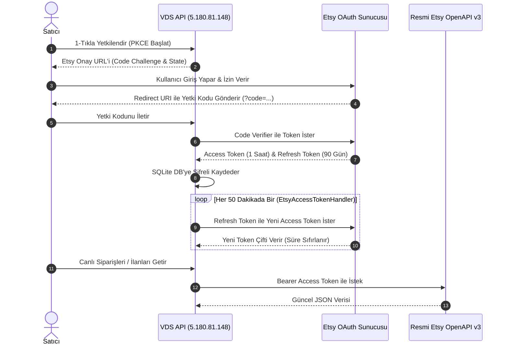

# 🔑 Etsy Entegrasyonu ve OAuth v3

EtsyMarketPlace, resmi **Etsy OpenAPI v3** standardını kullanır ve güvenli **OAuth 2.0 PKCE (Proof Key for Code Exchange)** protokolüyle kimlik doğrulaması yapar.

---

## 🛡️ OAuth v3 ve 90 Günlük Otomatik Yenileme Döngüsü

Etsy v3 OAuth sisteminde iki tür token bulunur:
1. **Access Token:** 1 saat geçerlidir. Etsy API uç noktalarına yapılan her istekte `Bearer <token>` olarak gönderilir.
2. **Refresh Token:** 90 gün geçerlidir. Access token'ın süresi dolduğunda yenisini almak için kullanılır. Her yenilemede yeni bir Refresh Token verilir ve 90 günlük sayaç sıfırlanır.

### Otomatik Yenileme Akışı (`EtsyAccessTokenHandler`)

---

## 🖥️ Masaüstü ve VDS Token Köprüsü

Etsy güvenlik politikaları veya ağ kısıtlamaları nedeniyle web üzerinden token yenileme yapılamadığında masaüstü programı köprü görevi görür:

1. Masaüstü uygulamasında **`⚙️ API Ayarları`** açılır.
2. **`OAuth link üret`** butonuna basılır ve **`Tarayıcıda aç`** denir.
3. Etsy sayfasından izin verilip yönlendirilen linkteki yetki kodu alınır.
4. **`Code ile token al`** butonuna tıklandığında masaüstü programı:
   - Etsy'den taze token çiftini alır.
   - Yerel profilde şifreler.
   - Otomatik olarak `IntegrationApiClient` üzerinden VDS API'nin `/api/etsy/token/import` ucuna yükler.
5. VDS API ve Web Kokpiti anında senkronize olur ve canlı verilere erişir.

---

## 🔒 Güvenlik ve İzin Kapsamları (Scopes)

Uygulamanın Etsy'den talep ettiği minimum yetki kapsamları:
- `shops_r`: Mağaza profili ve ayarlarını okuma.
- `listings_r`: İlanları, fotoğrafları, envanteri okuma.
- `listings_w`: AI ile optimize edilen başlık, açıklama ve 13 etiketi güncelleme.
- `transactions_r`: Sipariş, alıcı ve ödeme detaylarını okuma.
- `billing_r`: Ödeme defteri (ledger entries) ve finansal kesintileri okuma.
- `address_r`: Kargo gönderileri için müşteri teslimat adresini okuma.
- `email_r`: Kargo bilgilendirmesi ve bildirimler için müşteri e-postasını okuma.
