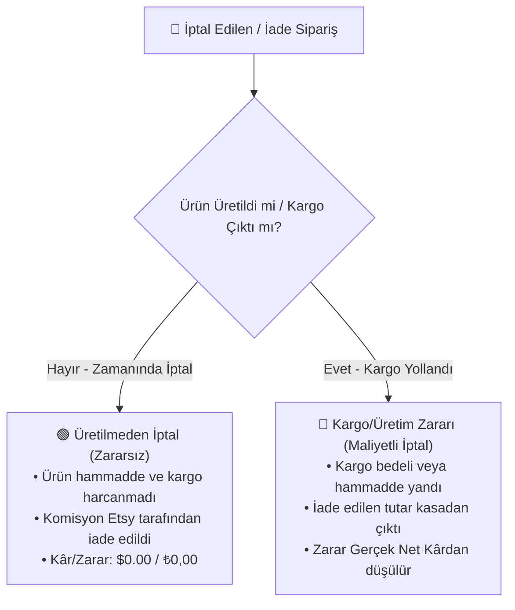

# 💹 Finans ve Muhasebe Motoru

EtsyMarketPlace'in en güçlü modüllerinden biri, resmi Etsy Ödeme Hesabı Defteri (Payment Account Ledger) verilerini işleyen **VDS Sunucu Finans Motoru**dur (`EtsyLedgerFinancialEngine` & `EtsyLedgerReportService`).

---

## 🧭 Temel Finans İlkeleri

1. **Tek Doğruluk Kaynağı (Single Source of Truth):** Web ve masaüstü finans göstergeleri (Brüt Satış, Gerçek Net Kâr, Etsy Kesintileri, İadeler) Etsy'nin ödeme defterindeki gerçek işlem satırlarından (`ledger-entries`) canlı olarak üretilir.
2. **Çift Para Birimi ($ / ₺):** Her satır ve işlem hem sipariş anındaki orijinal para biriminde ($ USD) hem de Türkiye Finans & Muhasebe karşılığında (₺ TRY) izlenir.
3. **Kurlar:**
   - **TCMB Kilitli Kuru:** Sipariş tarihindeki resmi merkez bankası kuru.
   - **Etsy Fiili Kuru (%2.5 FX Kesintili):** Etsy'nin USD satışları Türk Lirası banka hesabına gönderirken uyguladığı %2.5 dönüşüm marjı düşülmüş fiili kasa kuru.

---

## 📊 KPI Hesaplama Formülleri

| Metrik | Formül | Açıklama |
| :--- | :--- | :--- |
| **Brüt Satış (Gross Sales)** | $\sum \text{Satış İşlem Tutarları}$ | Müşterinin ödediği toplam brüt sipariş bedeli. |
| **Etsy Kesintisi (Fees)** | $\text{İşlem Bedeli} + \text{Komisyon} + \text{Listeleme} + \text{KDV}$ | Etsy'nin kestiği işlem komisyonları. İade edilen siparişlerin geri yatan komisyonları (`refunded fee`) bu tutardan düşülür. |
| **Dış Reklam (Offsite Ads)** | $\sum \text{Offsite Ad Kesintileri}$ | Etsy dışı reklamlar üzerinden gelen satış kesintileri (%12 veya %15). |
| **Etsy Net Gelir (Etsy Net)** | $\text{Brüt Satış} - \text{Etsy Kesintisi} - \text{Dış Reklam} - \text{İadeler}$ | Mağazanın banka hesabına aktarılacak saf Etsy bakiyesi. |
| **Sipariş Maliyeti** | $\sum (\text{Ürün Hammadde} + \text{Kargo} + \text{Paketleme})$ | Üretilen ve kargolanan ürünlerin satıcı maliyetleri. İptal edilen ancak kargolanmış siparişlerin maliyet zararları buraya dahildir. |
| **Gerçek Net Kâr** | $\text{Etsy Net Gelir} - \text{Sipariş Maliyeti}$ | Satıcının cebine giren kesin ve resmi net kâr. |

---

## 🔴 İptal ve İade Analizi (Zararsız vs Kargo/Maliyet Zararı)

Etsy üzerinde gerçekleşen iptal ve iadeler sisteme iki farklı kategoride yansıtılır:

### Önemli Noktalar:
1. **Geri Alınan Komisyon:** Bir sipariş iptal edildiğinde Etsy'nin iade ettiği komisyonlar yeşil renkle `+₺... (+S... USD)` olarak listelenir.
2. **Net Kasa Çıkışı (Kasa Kaybı):** Müşteriye iade edilen tutardan Etsy'nin geri verdiği komisyon düşüldükten sonra satıcının kasasından fiilen çıkan net paradır:
   $$\text{Kasa Kaybı} = \text{İade Tutarı} - \text{Geri Alınan Komisyon}$$
3. **Orijinal Tutar Görünürlüğü:** İptal edilen siparişler ana tabloda ve Satış Modalı'nda `$0.00` yerine asıl sipariş tutarıyla gösterilir ve `🔴 İptal Edildi` kırmızı rozetiyle vurgulanır.

---

## 🏦 Fon Rezervi & VDS Senkronizasyonu

Etsy'nin yeni satıcılara veya yüksek hacimli mağazalara uyguladığı **Etsy Ödeme Rezervi (Reserve Account)** takip edilir:
- **Kullanılabilir Bakiye (Deposit):** Hemen bankaya çekilebilecek tutar.
- **Rezervedeki Fon (%75):** Etsy'nin 45-60 gün blokede tuttuğu tutar.
- **VDS 1-Tık Senkron Yer İmi (Bookmarklet):** VDS Chrome sekmesindeyken tek tıkla canlı rezerv verisini VDS veritabanına aktarır (Sıfır ban riski).
