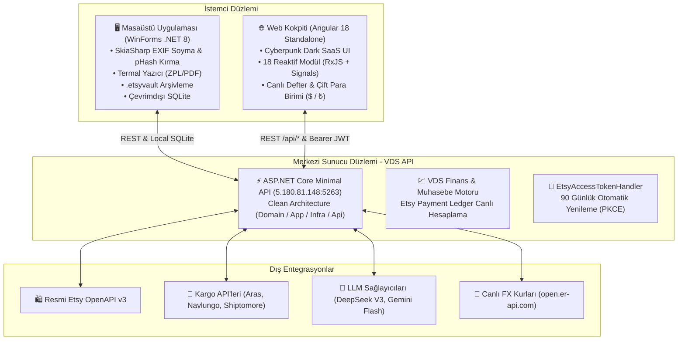

# 🚀 EtsyMarketPlace Enterprise Ecosystem — Wiki

**EtsyMarketPlace**, profesyonel Etsy satıcıları ve 3D baskı/özel üretim atölyeleri için sıfırdan geliştirilmiş, yüksek performanslı, **üç katmanlı hibrit bir e-ticaret yönetim ve komuta merkezidir**. 

Sistem; masaüstü Windows Forms istemcisi, Angular 18 modern SaaS web kokpiti, merkezi ASP.NET Core VDS API sunucusu ve AI destekli karar motorlarını tek bir çatı altında birleştirir.

---

## 🏛️ Mimariye Genel Bakış

Sistem üç temel çalışma düzleminde işler:

---

## 📚 Wiki İçindekiler Tablosu

Wiki sayfaları sistemin tüm teknik ve iş mantığı bileşenlerini ayrıntılı olarak açıklamaktadır:

| Sayfa | Açıklama |
| :--- | :--- |
| 🏗️ **[Mimari ve Sistem Tasarımı](Mimari-ve-Sistem-Tasarimi)** | Clean Architecture katmanları, WinForms mimarisi, Angular 18 modülleri ve SQLite veri modeli. |
| 💹 **[Finans ve Muhasebe Motoru](Finans-ve-Muhasebe-Motoru)** | Canlı defter (ledger) motoru, çift para birimi ($/₺), komisyon iadesi, kasa kaybı vs kargo zararı ayrımı. |
| 🔑 **[Etsy Entegrasyonu ve OAuth v3](Etsy-Entegrasyonu-ve-OAuth-v3)** | PKCE akışı, 90 günlük otomatik token yenileme (`EtsyAccessTokenHandler`), masaüstü-VDS senkronizasyonu. |
| 🚚 **[Kargo, Lojistik ve Anti-Ban](Kargo-Lojistik-ve-Anti-Ban)** | Aras, Navlungo, Shiptomore köprüleri, termal etiket basımı, SkiaSharp görsel EXIF sıyırma ve pHash kırma. |
| 🤖 **[Yapay Zeka ve Pazar Araştırması](Yapay-Zeka-ve-Pazar-Arastirmasi)** | DeepSeek & Gemini LLM motorları, 13 etiket kuralı, SEO optimizasyonu, Viral 3D avcısı ve A/B testleri. |
| 🛠️ **[Kurulum ve Geliştirici Rehberi](Kurulum-ve-Gelistirici-Rehberi)** | Yerel geliştirme ortamı, derleme (`ng build`, `dotnet build`), birim testler (874 test) ve Git Kural 2 akışı. |

---

## ⚡ Temel Prensipler & Kurallar

1. **Sıfır Mock İlkesi:** Arayüzde veya servislerde temsili sabit veri (mock) bulunmaz. Bütün finansal metrikler ve listelemeler resmi Etsy API ve SQLite defterinden canlı beslenir.
2. **Kusursuz Clean Architecture:** Controller sınıfları yalnızca HTTP karşılayıcıdır (Thin Controller). Bütün iş akışları `EtsyMarketPlace.Application` servislerinde ve MediatR komutlarında yürütülür.
3. **13 Etiket Kuralı:** Etsy SEO algoritmasının en kritik faktörü olan 13 etiketin her biri eksiksiz ve en az iki kelimelik hedeflenmiş kelimelerden üretilir.
4. **Anti-Ban Güvenliği:** Doğrudan Etsy web scraping yapılmaz; tüm görsel meta verileri SkiaSharp ile temizlenir ve API istekleri insan ritminde hız sınırlarıyla çalıştırılır.
